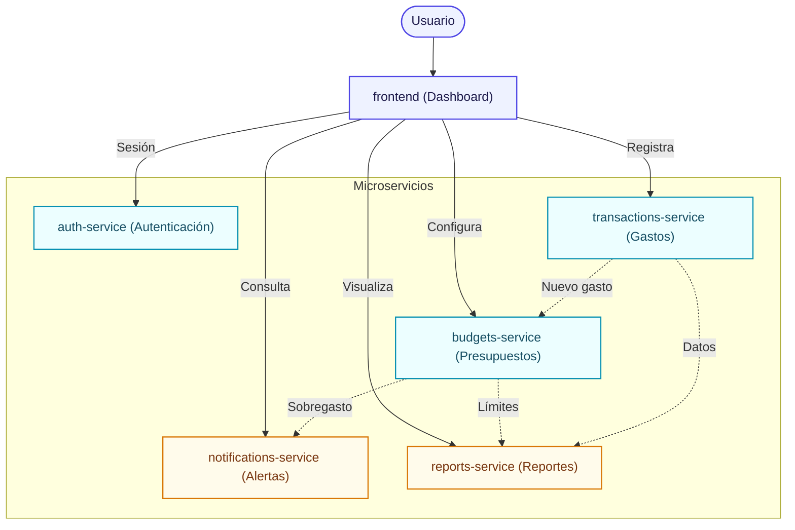

# Centavo

**Centavo** es una aplicación de finanzas personales diseñada para uso individual, enfocada en el registro de gastos, el control de presupuestos y la emisión de alertas de sobregasto.

El proyecto está organizado como un **monorepo** compuesto por un frontend (dashboard) y cinco microservicios independientes, cada uno en su propia carpeta.

## Estructura del monorepo

```text
centavo/
├── frontend/               # Dashboard web para el usuario
├── auth-service/           # Autenticación y gestión de sesión
├── transactions-service/   # Registro y categorización de gastos
├── budgets-service/        # Gestión de presupuestos y límites
├── notifications-service/  # Alertas y notificaciones de sobregasto
├── reports-service/        # Generación de reportes automáticos
└── README.md
```

## Propósito de cada pieza

### `frontend/`
Interfaz web (dashboard) desde la cual el usuario visualiza su resumen financiero, registra gastos, configura presupuestos por categoría, revisa alertas activas y consulta sus reportes.

### `auth-service/`
Microservicio encargado de la autenticación del usuario, emisión/validación de tokens de sesión y control de acceso hacia el resto de los servicios.

### `transactions-service/`
Microservicio responsable de registrar, consultar, editar y categorizar los movimientos y gastos personales del usuario.

### `budgets-service/`
Microservicio encargado de definir presupuestos (por categoría o período), calcular el gasto acumulado frente al límite configurado y detectar cuándo se supera o se acerca al umbral de sobregasto.

### `notifications-service/`
Microservicio dedicado a gestionar y despachar alertas (por ejemplo, avisos de sobregasto o recordatorios) generadas a partir de los eventos del sistema.

### `reports-service/`
Microservicio encargado de generar reportes automáticos y resúmenes periódicos (mensuales, por categoría, comparativas de presupuesto vs. gasto real) a partir de la información de transacciones y presupuestos.

## Diagrama de arquitectura



> **Lectura rápida:** Las líneas **continuas** (`──▶`) representan interacciones directas desde el dashboard; las líneas **punteadas** (`- - ▶`) representan comunicación interna o eventos entre microservicios.